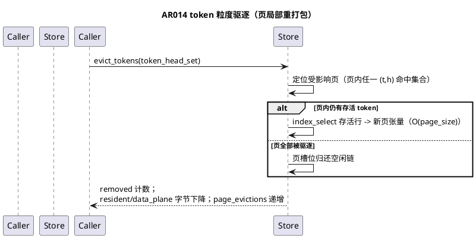

# 1 AR概述

| 组件名称 | shadowinfer / shadowkv 存储与执行层（PagedKVStore + PyTorchModelBackend） |
| --- | --- |
| AR系统流水号 | AR014 |
| AR描述 | 分页增量 KV 驻留：新增 `kv_execution="paged"` 执行模式。KV 以固定页大小、按精度分页驻留，append 步仅对新 token 量化入页（摊销 O(S_new)），已封存页不可变且永不重打包；读取经页表批量 gather 单遍解包；token 粒度驱逐按页局部重打包存活行并归还空闲链槽位。与现行 packed 全量重打包路径逐元素（bitwise）等价，消除 append 每步 O(S_total) 的再量化与全量瞬态分配。 |

**选型结论（三方案对比后采用方案 A）**：页采用模型布局 `[B, H, T_page, D]`，行级量化与 `PackedKVCache` 行级 scale 粒度对齐（int8 scale `[B,H,T,1]`、int4 行组 scale、行级字节打包），gather 按页序单遍拼装；弃用行堆叠布局（方案 B，每页需昂贵 scatter）与预分配槽位池（方案 C，池满扩容违背「永不重打包」不变量）。

# 2 动态行为

## 交互时序图

```plantuml
@startuml
title AR014 paged 执行模式：append 步（无驱逐）
participant Orch as Orchestrator
participant BE as PyTorchModelBackend
participant Store as PagedKVStore (per layer)
participant Model as SimpleDiffusionLLM

Orch -> BE: forward_step(x, step_cfg)
BE -> Store: gather(layer_id)
Store --> BE: (k_past, v_past) [B,H,S_past,D] float32
BE -> Model: forward_step(x, kv_cache={layer:(k,v)})
Model --> BE: logits, new_raw_kv = (k_full, v_full) [B,H,S_past+S_new,D]
BE -> BE: new_k = k_full[:,:,S_past:,:]
BE -> Store: append(layer_id, new_k, new_v, precision)
note right: 仅新 token 量化入页；\n封存页对象不可变；\n空闲链槽位优先复用
Store --> BE: 无异常
BE --> Orch: output / kv_cache / execution_stats\n(paged, appended_tokens, repack_tokens_saved=S_past)
@enduml
```



# 3 功能点分解

| 序号 | 功能点名称 | 功能点描述 | SRS 追溯 |
| --- | --- | --- | --- |
| 1 | PagedKVStore 核心数据结构 | 页表间接寻址、按精度分页池、空闲链、双口径记账 | FR14.1 |
| 2 | 增量 append | 尾部开放页填充 + 新页分配，摊销 O(S_new)，封存页不可变 | FR14.2 |
| 3 | 批量 gather | 单遍拼装 `[B,H,S,D]` float32，与 unpack 布局一致 | FR14.3 |
| 4 | token 粒度驱逐 | 页局部重打包存活行 + 空闲链复用，无全量重打包 | FR14.4 |
| 5 | 后端 paged 执行模式 | kv_execution="paged" 接线、replace 兼容、reset、fallback、执行统计 | FR14.5 |
| 6 | orchestrator 透传 | page_size/kv_execution 配置、reset、统计透传 | FR14.6 |
| 7 | 等价性验证与基准 | golden UT（fp16/int8/int4 bitwise）+ ar014_bench 实测落档 | FR14.6 |

# 4 实现设计

## 4.1 功能实现思路

1. **页为精度边界**：每页持有单一精度；后端每步统一精度时新页精度即当前步精度，历史页保持原精度不重写——精度变化天然由新页承载，gather 按 precision 分组解码。
2. **量化行级对齐**：`Quantizer.quantize_int8/quantize_int4` 的 scale 均按最后维计算（行局部），`_pack_int4_rows` 行级独立打包；因此对页内 `[B,H,T,D]` 张量按 `(b,h,t)` 行在 `head_dim` 上量化，其 scale 值与 `PackedKVCache` 对同一元素的行级 scale **逐位相同**——golden 等价为 `torch.equal` 级，而非容差级。
3. **gather 两条路径**：全满页且无洞（驱逐未发生）时单次 `torch.cat` + 精度解码；存在洞（驱逐后）时预分配 `[B,H,max_seq,D]` 零填充，逐页切片赋值（每页一次向量化拷贝，O(S_total) 小常数）。
4. **append 切分依据**：模型在 append 语义下返回 past+new 全量张量；`past_len = raw_cache[layer_id][0].shape[2]`（无历史则 0），新 token 即 `[:, :, past_len:, :]`。shape mismatch reset 清空 raw_cache 后 past_len=0，全量按新 token 入页，语义自洽。
5. **失败兜底**：页 append/gather 抛异常时该层回退 dense 量化条目并置 `fallback=True`（口径沿用 AR013 packed fallback）。

## 4.2 功能实现设计

### 4.2.1 流程图

```plantuml
@startuml
title PyTorchModelBackend.forward_step（paged 分支决策）
start
:读取 kv_cache entries;
if (entry.paged_kv 存在?) then (是)
  if (页 num_heads/head_dim 与模型不匹配?) then (是)
    :reset_reason="shape_mismatch"\n清空 kv/packed/paged 缓存;
  else (否)
    :raw_cache[layer] = paged_kv.gather();
  endif
else (否)
  if (entry.packed_kv 存在?) then (是)
    :raw_cache[layer] = packed_kv.unpack();
  else (否)
    :raw_cache[layer] = _dequantize_kv(entry);
  endif
endif
:模型 forward_step 得 new_raw_kv (全量);
:past_len = raw_cache 中该层历史长度;
:new_k/new_v = full[:,:,past_len:,:];
if (kv_execution == "paged"?) then (是)
  try
    :store.append(new_k, new_v, precision)\n(首次: 新建 PagedKVStore);
    :统计 appended_tokens/repack_tokens_saved += past_len;
  catch (异常)
    :fallback dense 条目 + fallback=True;
  endtry
else (否)
  :沿用 dense/packed 既有路径（不变）;
endif
:更新 execution_stats（paged 键组）;
stop
@enduml
```

### 4.2.2 流程说明

- **首次步**：某层无历史时创建 `PagedKVStore(batch, heads, page_size, head_dim, int4_group_size)` 并全量入页；store 实例挂在 `KVCacheEntry.paged_kv` 字段与后端 `_paged_cache[layer_id]`（与 `_packed_cache` 平行，便于 reset/统计）。
- **开放页填充**：append 优先写入尾部开放页至 `page_size` 后封存；跨页边界的新 token 依次开新页；空闲链非空时新页槽位复用。
- **replace 生命周期**：每步 `store.clear()` 后全量入页（整页集重写），语义正确、不宣称收益。
- **驱逐**：`evict_tokens(token_head_set)` 与 `PackedKVCache.evict` 的 (t,h) 粒度语义对齐：
  - 页内某 token 的**全部** H 个 (t,h) 均在集合中 → 该 token 从页中删除（字节真实释放）；
  - 页内某 token 仅**部分** head 在集合中 → token 保留原位置，被驱逐 head 的行在页 payload 中清零（fp：置 0；int8：q 置 0；int4：该行打包字节置 0x88，即 codes 0 的偏移编码——解码为 0.0），页粒度下无字节节省（诚实代价）；
  - 删除 token 造成页内位置空洞 → 该页按**连续存活段**拆分为多个页（各段 start_token 保持原位；首段复用原槽位，其余段从空闲链/新槽位分配，按 token 序插入 `_order`）；
  - 整页全驱逐 → 槽位归还空闲链；`page_evictions` 按受影响页计数累加；
  - 返回值 = 实际移除的 (t,h) 对数（已驱逐的不重复计数、不复活）；
  - gather 在洞位置保持零值（与 `PackedKVCache.unpack` 对 EVICTED 条目的零填充语义一致），可构造 golden 驱逐等价测试（同数据同集合，paged gather == packed evict+unpack 逐元素）。

## 4.3 接口描述

### 4.3.1 新增模块接口：`shadowinfer/shadowkv/paged_kv_store.py`

```python
class PagedKVStore:
    # 每层一个实例（与 PackedKVCache 惯例一致，挂 KVCacheEntry.paged_kv
    # 与后端 _paged_cache[layer_id]）
    def __init__(self, batch_size, num_heads, head_dim, page_size=32,
                 device="cpu", int4_group_size=16) -> None
    # FR14.2 增量 append：仅新 token 量化入页；precision ∈ fp32/fp16/int8/int4
    def append(self, k_new: Tensor, v_new: Tensor, precision: str) -> None
    # FR14.3 单遍 gather：返回 [B,H,max_seq,D] float32，零填充洞位
    def gather(self) -> Tuple[Tensor, Tensor]
    # FR14.4 token 粒度驱逐：返回移除的 (token,head) 计数
    def evict_tokens(self, token_head_set: Set[Tuple[int, int]]) -> int
    def clear(self) -> None                       # replace/重置
    @property
    def max_seq(self) -> int                      # 已见最大 token 位置 +1
    @property
    def page_count(self) -> int                   # 封存页+开放页总数
    @property
    def open_pages(self) -> int
    @property
    def appended_tokens(self) -> int              # 累计
    @property
    def page_evictions(self) -> int
    def data_plane_bytes(self) -> int             # 张量字节（含 scale，AR013 口径）
    def resident_bytes(self) -> int               # 另含 48B/token-head + 页表槽位开销
    def validate_against(self, batch, heads, head_dim) -> None  # shape 不匹配抛 ValueError
```

- **页内部结构**：`pages: List[Optional[Page]]`，`Page = {precision, k, v, scale_k, scale_v, start_token, num_tokens, sealed}`；`k/v` 形状 `[B,H,page_tokens,D]`（fp16 存 half，int8 存 int8 + `scale_k [B,H,page_tokens,1]`，int4 存行打包 uint8 `[B,H,page_tokens,ceil(D/2)]` + `scale_k [B,H,page_tokens,num_groups,1]`）。
- **空闲链**：`free_slots: List[int]`（`pages` 列表槽位索引复用）。

### 4.3.2 修改接口：`shadowinfer/core/structs.py`

`KVCacheEntry` 新增可选字段 `paged_kv: Optional[Any] = None`（与 `packed_kv` 平行，默认 None，无 API 破坏）。

### 4.3.3 修改接口：`shadowinfer/core/backends/pytorch_backend.py`

- `configure_execution(..., kv_execution ∈ {"dense","packed","paged"}, page_size: int = 32)`；`page_size >= 1` 校验；
- `reset_execution_state()` 增清 `self._paged_cache`；
- `forward_step` 按 §4.2.1 流程图扩展；
- shape mismatch 检测循环扩展 paged 条目（`num_heads/head_dim` 对比）；
- `_entry_kv_tensors` 扩展：`entry.paged_kv` → `paged_kv.gather(各层)`（orchestrator fallback 消费路径）；
- `execution_stats` 新增键：`paged: bool`、`page_size`、`page_count`、`open_pages`、`appended_tokens`（当步）、`appended_tokens_total`、`repack_tokens_saved`（当步 past token 数）、`page_evictions`。

### 4.3.4 修改接口：`shadowinfer/orchestrator.py`

- `_maybe_configure_execution` 透传 `execution.get("page_size")`（缺省 32）；
- run_baseline / run_optimized / run_stream 起点 reset 已调用 `reset_execution_state()`（AR013 既有），paged 状态随之清理，无需新增调用点；
- `execution_stats` 沿既有通道透传（`state.kv_result["execution"]` / profiler），新增键自动携带。

### 4.3.5 内部依赖（既有，不改对外语义）

- `shadowinfer/utils/quantization.py`：`Quantizer.quantize_int8/quantize_int4/dequantize_int8/dequantize_int4`（行级语义，直接复用）；
- 行级 int4 字节打包复用 `PackedKVCache._pack_int4_rows` 的打包语义（在 PagedKVStore 内实现同语义的行打包辅助，不改动 PackedKVCache）。

## 4.4 代码设计

```plantuml
@startuml
title AR014 模块关系
package shadowinfer {
  package shadowkv {
    class PagedKVCacheStub
    class PackedKVCache
    class PagedKVStore <<new>>
  }
  package core {
    class KVCacheEntry { +paged_kv: Optional[Any] <<new>> }
    package backends {
      class PyTorchModelBackend {
        +configure_execution(kv_execution, page_size)
        -_paged_cache: Dict[int, PagedKVStore] <<new>>
      }
    }
  }
  class orchestrator.Orchestrator {
    +execution.page_size 透传 <<new>>
  }
  package utils {
    class Quantizer
  }
}
PyTorchModelBackend ..> PagedKVStore : append/gather/fallback
PyTorchModelBackend ..> PackedKVCache : 既有路径不变
PyTorchModelBackend ..> Quantizer
PagedKVStore ..> Quantizer : 行级量化/去量化
KVCacheEntry o-- PagedKVStore : paged_kv
orchestrator.Orchestrator ..> PyTorchModelBackend : configure/reset/stats
@enduml
```

**模块化要点**：
- `PagedKVStore` 与 `PackedKVCache` 同层（`shadowinfer/shadowkv/`），互不依赖；共同依赖 `Quantizer`（行级语义为二者 bitwise 对齐的契约点）；
- 后端 `_paged_cache` 与 `_packed_cache` 平行持有活跃 store，`KVCacheEntry` 持久引用保证条目级一致性；
- 新增文件仅 1 个（`paged_kv_store.py`）、新测试文件 1 个（`test_paged_kv_execution.py`）；其余为定点扩展，无目录结构变化。

# 5 重构设计（可选）

无独立重构；`_pack_int4_rows` 行打包语义在 PagedKVStore 内以私有辅助函数对齐实现（不改 `PackedKVCache`，避免动已归档行为）。

# 6 测试设计

## 6.1 单元测试（UT）

`tests/test_paged_kv_execution.py`（新增，预计 20+ 用例）：
1. **golden 等价组**：随机张量逐步 append（fp16/int8/int4 三精度）后 `gather()` 与 `PackedKVCache.pack(全量, 同精度图).unpack()` 逐元素 `torch.equal`；含跨页边界（seq 非页倍数）、多步追加；
2. **不可变组**：封存页对象 `id()` 与张量 `data_ptr()` 跨后续 append 步不变；开放页仅尾部增长；
3. **驱逐组**：`evict_tokens` 后 gather 排除洞位（零填充）、字节下降、`page_evictions` 递增；空闲链复用（驱逐后再 append 槽位数不增长）；全页驱逐边界；
4. **校验组**：非法 precision/shape/layer 抛 `ValueError`；空 store gather 返回空序列；
5. **记账组**：`data_plane_bytes` ≤ 等价 dense FP16 字节；`resident_bytes ≥ data_plane_bytes`；fp16 页 `data_plane == dense`（无压缩预期）。

## 6.2 接口测试

- `configure_execution(kv_execution="paged", page_size=…)` 合法/非法值；默认行为不变（dense 默认路径回归由既有 876 用例守护）；
- `execution_stats` 键存在性与单调性：`appended_tokens_total`/`repack_tokens_saved` 随步累加，`paged=True`；
- orchestrator 配置化端到端：`execution.kv_execution="paged"` 跑通且 `state.kv_result["execution"]` 携带新键。

## 6.3 业务场景测试

- **端到端等价**：同种子同输入，后端 paged vs packed 全流程 logits `torch.equal`（fp16）；int8 路径与 packed 等价；
- **replace 兼容**：`kv_lifecycle="replace"` + paged 跑通，语义正确；
- **reset**：run 间 `reset_execution_state()` 后 paged 状态干净（page_count=0）；
- **shape mismatch**：注入不匹配 entry 触发 `reset_reason="shape_mismatch"` 且页集重建。

## 6.4 异常场景测试

- append 中途异常（构造非法 shape 触发）→ 该层回退 dense 条目、`fallback=True`、后续步可继续；
- gather 空洞（驱逐后）输出零填充不越界；
- 开放页未满即驱逐的边界（存活行重打包正确）。

## 6.5 基准测试（`specs/changes/AR014-paged-kv-store/ar014_bench.py`）

- 规模点：(N=8, S_new=64) 与 (N=16, S_new=128)，L=8/H=8/D=64/B=4，页 32；
- baseline=packed 全量重打包，对照=paged；速度 3 seeds（中位+区间）；
- 预注册断言：两规模点总时间加速比 ≥ 1.5x；每步延迟线性拟合斜率 paged < baseline 的 60%；fp16 logits relL2 == 0；瞬态峰值（tracemalloc）paged < baseline；
- 原始数值/配置/复现命令落档 `bench-results.md`（规则 1.1）。
