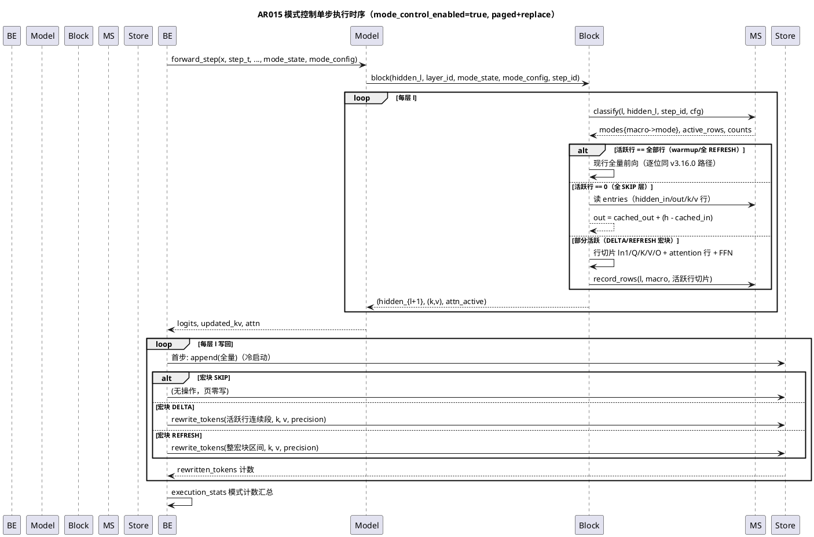
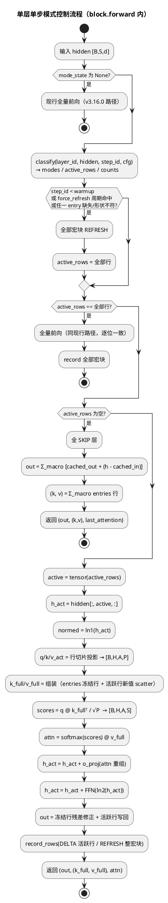

# 1 AR概述

| 组件名称 | ShadowInfer 执行平面（execution plane）+ ShadowKV 分页驻留 |
| --- | --- |
| AR系统流水号 | AR015 |
| AR描述 | 收敛感知宏块 KV 模式控制：在 `kv_execution="paged"` + `kv_lifecycle="replace"` 上，按 (layer, macro-block) 将 token 区间分类为 SKIP（零重算+残差修正）/ DELTA（仅活跃行重算+页内直写）/ REFRESH（整块重算覆写），行粒度漂移门控 + warmup + 周期强制刷新；关闭时全部既有路径逐位不变。 |

# 2 动态行为

## 交互时序图



# 3 功能点分解

| 序号 | 功能点名称 | 功能点描述 | 追溯 |
| --- | --- | --- | --- |
| 1 | 页内行直写 | `PagedKVStore.rewrite_tokens`：行级 re-quantize + payload/scale slice 覆写、跨页拆分、驱逐行拒写、失败原子性、记账 | FR15.1 |
| 2 | 模式分类器 | `MacroModeController`（macro_mode.py）：行粒度漂移、SKIP/DELTA/REFRESH 单门+比例门分类、warmup、force_refresh_every、计数 | FR15.2 |
| 3 | 行粒度分段前向 | `DiffusionTransformerBlock` 活跃行切片前向：切片投影/attention 行/FFN、冻结行残差修正、key 侧完整性 | FR15.3 |
| 4 | 后端模式执行 | configure 参数与校验、写回三分派、fallback、统计新键 | FR15.4 |
| 5 | 编排接线 | `**cfg` 透传、统计双通道、HF 不支持口径 | FR15.5 |
| 6 | 基准与协议 | 三臂基准（baseline/AR013/AR015）、预注册断言、s10 GPU 协议、实验落档 | FR15.6 |

# 4 实现设计

## 4.1 功能实现思路

**方案比选**（核心问题：模式状态如何挂载与穿透）：

- **方案 A（选定）：独立 MacroModeState 平行挂载**——新增 `execution/macro_mode.py`（MacroModeConfig/MacroModeState/MacroBlockEntry），模型 `forward_step` 与 block.forward 增加可选参数 `mode_state`/`mode_config`（与 AR013 的 `reuse_state`/`reuse_config` 完全平行）；模式关闭时参数为 None，代码路径零变化。
  - 优点：AR013 `StepReuseState` 零改动（互斥由配置校验保证）；关闭=逐位回归的证明平凡；仓库先例完全同构（AR013 挂载模式复刻）。
  - 缺点：模型 forward 参数再增两个（可接受，向后兼容可选参数）。
- **方案 B（弃）：泛化 StepReuseState 为统一 (layer, macro) 状态**——把 AR013 状态结构改造为宏块化，step_reuse 变为 macro_block_size=S 的特例。
  - 弃因：违反 SRS「不修改 AR013 既有行为」约束；876 基线回归面大；收益仅是省一个类。
- **方案 C（弃）：模式判定放后端、模型只暴露行切片原语**——后端需要每层 hidden 才能分类，但模型只返回最终 logits，必须改模型 API 暴露中间态，侵入性反而更大。

**关键机制决策**：

1. **分类门控（单门+比例门，迟滞内建）**：行活跃 iff `drift_row >= skip_threshold`（0.1，对齐 AR013）；宏块 SKIP iff 零活跃行；活跃比 >= `delta_min_active_ratio`（0.5）→ REFRESH，否则 DELTA。任一活跃行当步即时解除冻结（无需独立 unfreeze 参数——SKIP 的定义保证迟滞语义自动成立）。
2. **key 侧完整性**：attention 的 K/V = 冻结行缓存（entries 的 k/v 行，fp32）+ 活跃行新投影，按原 token 位置 scatter 回全序列布局；attention 仅算活跃行 scores/softmax/attn·V。冻结行输出 = `cached_out + (h - cached_in)`（AR013 残差修正的行粒度推广；attention 跨行耦合误差由 drift 门控 + `force_refresh_every` 保险，relL2 预算 <= 2% 实测验证——沿 AR013 实证口径，不做无损声称）。
3. **全活跃捷径**：`active_rows == 全部行` 时直接走现行全量前向代码（不进切片路径）——warmup 步与关闭态的逐位一致性由此平凡保证，且避免无谓切片开销。
4. **batch 均匀性**：模式与活跃集定义在 seq 轴；某 seq 行任一 batch 元素漂移超阈即该行活跃（与页布局 batch 均匀、rewrite_tokens 连续段语义一致）。
5. **DELTA 行集写回**：活跃 seq 索引分解为连续段（runs），每段一次 `rewrite_tokens`；REFRESH 一次覆写整宏块区间。SKIP 宏块页零写（页对象 `id()` 不变，可断言）。

## 4.2 功能实现设计

### 4.2.1 流程图



### 4.2.2 流程说明

1. **classify**（MacroModeState）：对每个宏块取 entry，逐 (b,s) 行计算 `||h[b,s] - e.hidden_in[b,s]|| / ||e.hidden_in[b,s]||`（分母 <=0 视为漂移无穷大→活跃）；seq 行活跃 iff 任一 batch 元素超阈。entry 缺失/形状不符 → 该宏块 REFRESH 并失效旧 entry（不崩溃）。warmup（`step_id < warmup_steps`）或 `force_refresh_every>0 且 step_counter % f == 0` → 全部 REFRESH。输出 per-layer 计数（skip/delta/refresh 块数、skipped_rows、active_rows）。
2. **行切片前向**：LN/投影/FFN 均为逐行算子（last-dim 归一/行独立 matmul），切片结果与全量**逐位一致**（CPU 确定性下 UT 实证）；attention 只算活跃行 [B,H,A,S]。key 侧组装 `k_full`：`empty[B,H,S,P]` 按 entries 冻结行 fill + 活跃行 scatter 新值——这是 replace 生命周期下「全序列 K/V」的唯一权威构造，与全量前向 k/v **逐位相等**（UT 实证）。**诚实边界修正（实测）**：活跃行输出对全量前向**不逐位**——attention matmul 在 M=A 与 M=S 下 CPU 内核分块不同、归约序不同，实测 relL2 ≈ 7.7e-8（末位噪声）；UT 以 relL2 <= 1e-6 量化容差断言（T003 实证），远低于 e2e relL2 <= 2% 预算。
3. **record_rows**：REFRESH → 整宏块 entry 替换（hidden_in/hidden_out/k/v 全量 detach 拷贝）；DELTA → entry 张量上活跃行 `index_copy`（行级覆写，detach）；SKIP → 不触碰（漂移对上次全量计算累积，AR013 同语义）。`last_attention` 记录最后计算层的活跃行 scores（标注为子集；AR013 的跨层共享缺陷不在本 AR 修复范围，沿用现状）。
4. **后端写回**（paged 分支内）：`store` 不存在（首步）→ 创建 + `append` 全量（冷启动，全部计 REFRESH）；`store.max_seq == S` → **不 clear**，按模式分派：SKIP 零调用；DELTA 对活跃行连续段逐段 `rewrite_tokens`；REFRESH 对整宏块区间 `rewrite_tokens`。`store.max_seq != S` → 走既有 shape-mismatch reset 路径。
5. **fallback**（沿 AR014 写路径保护先例）：模式路径模型调用与 rewrite 包裹 try；异常 → `fallback=True` + 原因，本步降级为关闭模式的全量重算（dense），`_mode_state.reset()`；后续步自动重建（首步语义）。
6. **统计**：每步汇总各层计数；`rewritten_rows` 来自各 `rewrite_tokens` 返回值之和；`projected_rows` = Σ|active_rows|（真实投影行数）；模式路径下 `repack_tokens_saved` 语义扩展为 `S - rewritten_rows`（SKIP/DELTA 冻结行视同免重打包，UT 断言精确值；关闭模式时口径不变）。

### 4.3 接口描述

**新增模块 `shadowinfer/execution/macro_mode.py`**：

```python
@dataclass(frozen=True)
class MacroModeConfig:
    enabled: bool = False
    macro_block_size: int = 32      # >= 1
    skip_threshold: float = 0.1     # 行漂移门，>= 0
    delta_min_active_ratio: float = 0.5   # [0,1]
    warmup_steps: int = 1           # >= 0
    force_refresh_every: int = 0    # 0=关闭
    def validate(self) -> None: ...  # __post_init__ 调用

@dataclass
class MacroBlockEntry:
    hidden_in: torch.Tensor   # [B, mb, d]
    hidden_out: torch.Tensor  # [B, mb, d]
    k: torch.Tensor           # [B, H, mb, P]
    v: torch.Tensor           # [B, H, mb, P]

@dataclass
class MacroModeState:
    entries: Dict[Tuple[int, int], MacroBlockEntry]   # (layer_id, macro_idx)
    # 计数/记账字段 + reset()/begin_step()
    def classify(self, layer_id, hidden, step_id, config)
        -> Tuple[Dict[int, str], List[int]]           # modes, active_rows
    def record_rows(self, layer_id, macro_idx, seq_slice, hidden_in, hidden_out, k_rows, v_rows) -> None
    def stats(self) -> Dict[str, Any]
```

**PagedKVStore 新增**（其余 API 不变）：

```python
def rewrite_tokens(self, start_token: int, k_new, v_new, precision: str) -> int
# 覆写 [start_token, start_token+T)；返回 T。
# 校验（全部先于任何变异——失败原子性）：
#   precision 合法且与所有命中页一致；k_new/v_new 4-D 同 store 维度；
#   0 <= start_token, start_token+T <= max_seq, T >= 1；
#   区间内不存在已驱逐 (token, head)（否则 ValueError 防复活歧义）。
# 语义：命中页 payload 与 scale 沿 dim=2（token 轴）行级 slice 赋值
#   （复用 _quantize_chunk，行级量化与 append 完全同路径 → golden bitwise）；
#   跨页自动拆分；页边界/start_token/num_tokens/sealed 状态不变；
#   未覆写行 payload 字节与 scale 逐位不变。
# 记账：_rewritten_tokens += T；_rewritten_pages += 命中页数；
#   data_plane_bytes/resident_bytes 不变（同布局）。
```

**模型接口扩展**（可选参数，默认 None，关闭时零影响）：

```python
# SimpleDiffusionLLM.forward_step 增：
#   mode_state: Optional[MacroModeState] = None
#   mode_config: Optional[MacroModeConfig] = None
# DiffusionTransformerBlock.forward 增同两参；forward_step 透传至 block。
```

**后端 `configure_execution` 新增参数**：`mode_control_enabled=False, macro_block_size=32, skip_threshold=0.1, delta_min_active_ratio=0.5, mode_warmup_steps=1, force_refresh_every=0`。校验：`mode_control_enabled=True` 时须 `kv_execution=="paged"` 且 `kv_lifecycle=="replace"`，且 `step_reuse_enabled=False`，否则 `ValueError`（显式 opt-in，不做静默禁用）。

**execution_stats 新增键**：`mode_control`（bool）、`macro_block_size`、`skip_blocks`、`delta_blocks`、`refresh_blocks`、`skipped_rows`、`rewritten_rows`、`projected_rows`（八键）。

### 4.4 代码设计

```
shadowinfer/
├── execution/
│   ├── step_reuse.py        # AR013，零改动
│   └── macro_mode.py        # 新增：Config/Entry/State（分类+记录+计数）
├── models/
│   └── simple_diffusion_llm.py  # block 增模式分支（全量捷径/全 SKIP/行切片）
├── shadowkv/
│   └── paged_kv_store.py    # 增 rewrite_tokens + 两个计数属性
└── core/backends/
    └── pytorch_backend.py   # configure 校验、模式状态生命周期、写回分派、fallback、统计
orchestrator.py              # 预期零改动（configure(**cfg) 透传，AR013/014 通道）
tests/
├── test_macro_mode_execution.py      # 新增：T001-T005 UT
└── (既有测试零修改——默认关闭逐位回归由全量 pytest 保证)
specs/changes/AR015-macro-block-mode-control/
└── ar015_bench.py            # 三臂基准
configs/experiments/s10_mode_control_gpu.yaml
```

**模块化要点**：

- **分层不变量**：macro_mode.py 只做状态与分类（不 import 模型/后端）；模型只消费分类结果做切片算术（不 import 后端）；后端只做编排分派。三者可独立 UT。
- **sealed 页纪律放宽的边界**：`rewrite_tokens` 是页 payload 的唯一突变入口（append 只写开放尾页）；放宽为「允许行覆写、禁止重排/合并/改变页边界」；该纪律写进 `_Page` docstring 与 UT（覆写后未触碰行逐位不变、页对象身份不变）。
- **互斥保证**：后端配置校验层拒绝 `mode_control + step_reuse` 同开与非法组合；模型层不重复校验（单一职责，配置错误在 configure 尽早暴露）。
- **MVP 靠拢**：分类器/切片前向/直写三者各自独立可测且默认关闭——任何一环可单独回退而不影响其余路径。

# 5 重构设计

无重构。AR013 `StepReuseState` 与 `last_attention` 跨层共享缺陷（simple_diffusion_llm.py:88-90/120）沿用现状，不在本 AR 修复（模式路径返回活跃行子集 scores 并在文档标注；修复留给后续 AR）。

# 6 测试设计

## 6.1 单元测试

`tests/test_macro_mode_execution.py`（零 mock；monkeypatch 仅用于故障注入，AR013 先例）：

- **T001 rewrite_tokens**：(a) 三精度 golden：append(原内容) 后 rewrite(区间, 新内容) 的 gather 输出 == 直接以新内容 append 的参考（torch.equal，bitwise）；(b) 跨页（macro=64/page=32）两页各自覆写、未触碰页/行逐位不变；(c) 驱逐行区间拒写（ValueError）且未覆写行不变；(d) 越界/形状/精度不匹配/空区间 ValueError + 状态不变异（失败原子性）；(e) 记账：rewritten_tokens/rewritten_pages 精确、data_plane/resident_bytes 不变；(f) sealed 页覆写后页对象 `id()` 不变。
- **T002 分类器**：构造冻结/漂移轨迹分类正确（SKIP/DELTA/REFRESH 边界与活跃集解析预期）；迟滞即时解除；warmup 全 REFRESH；force_refresh_every 周期命中；entry 缺失/shape 不符全 REFRESH 不崩溃；零范数分母行活跃。
- **T003 行切片前向**：(a) 活跃行输出 vs 全量前向逐元素相等（构造：活跃行外输入与缓存一致）；(b) 全 REFRESH/全活跃 == 现行路径逐位一致；(c) 全 SKIP 层输出 = 残差修正值、(k,v)=entries 行拼接；(d) 关闭（mode_state=None）与 v3.16.0 逐位一致；(e) 空活跃行合法。
- **T004 后端**：配置校验（互斥/前置组合 ValueError、非法参数值）；三臂分派（SKIP 页 id 不变、DELTA 连续段 rewrite 次数、REFRESH 整块）；首步冷启动 append 全量；统计八键正确性与单调性；fallback（注入 rewrite 异常）置位、降级全量、后续步恢复。
- **T005 接线/回归**：orchestrator `**cfg` 透传 + 统计双通道；HF 后端不支持口径（沿现有 configure 缺失处理，不崩溃）；默认关闭全量逐位回归（跑既有关键路径对照）；模式控制 e2e relL2 实测（vs 无门控 golden，阈值宽松的 smoke 断言 <5%，精确预算由 bench 把关）。

## 6.2 接口测试

- `configure_execution` 新参数全组合校验错误信息可读；`rewrite_tokens` 签名与返回值契约（返回 T）；`MacroModeConfig.validate` 全非法值逐一拒绝；`execution_stats` 新键类型与缺省（关闭时键存在且为 0/False，或键不出现——采用「键恒存在」口径，避免消费方 KeyError，与 AR014 一致）。

## 6.3 业务场景测试

- **受控 denoising 轨迹**（bench 的 UT 级缩小版）：sigma 递减 6 步，真实模型跑模式控制 vs 无门控 golden——冻结率随步递增、末半程 >= 30%、relL2 <= 2%（预注册断言的 UT 化）。
- **块式半 AR 叙事缩小版**：前 3/4 序列冻结（模拟已生成块）+ 末 1/4 持续刷新（模拟当前块）——历史块恒 SKIP、当前块 REFRESH，页零写与整块覆写交替的端到端场景。

## 6.4 异常场景测试

- rewrite 失败（monkeypatch 注入 `rewrite_tokens` 抛错）→ fallback 置位 + 本步全量降级 + 后续步重建恢复（历史不丢：store 页保留，模式状态重置后重建）。
- shape 突变（S 变化）→ 既有 shape-mismatch reset 路径接管 + 模式状态清空。
- reset_execution_state / run_* 起点 reset 覆盖模式状态（无跨轮泄漏，AR013 产物隔离先例）。
- 配置错误（mode_control + step_reuse 同开、paged/replace 缺一、macro_block_size=0、ratio>1）→ configure 阶段 ValueError（不进 forward）。

## 6.5 基准测试（T006，`ar015_bench.py`）

- 三臂：**baseline**（replace+dense 全量重算）/ **AR013**（replace+packed+reuse, threshold=0.1）/ **AR015**（replace+paged+mode, 默认参数）；真实 `SimpleDiffusionLLM` forward；`torch.set_num_threads(1)`；3 seeds（0/1/2）报中位与区间。
- **修订记录（2026-10-21，T006 首跑后）**：原预注册「均匀轨迹 x_t = x0 + sigma_t·noise + ≥2x 断言」首跑失败（实测加速 0.49-0.84x、relL2 最高 3.1%）。根因分析：均匀 sigma 使全部行同步漂移，行粒度分类退化为全有全无（freeze 仅 0/1.0，DELTA 机制不出现），6 步中仅 2 步可冻结 → ≥2x 在该轨迹上数学不可达；全 SKIP 步漂移对上次全量计算累积致 relL2 超预算。**该负结果如实保留为 T1 边界案例（不做断言、只报告）**。基准修订为双轨迹，断言集在 T2 跑之前登记：
  - **T1 均匀 sigma（边界案例，原预注册轨迹）**：sigma 0.9→0.02 六步；仅报告（加速比、relL2、冻结率），不做断言——诚实呈现机制在「全体行同步收敛」工作负载下的真实边界。
  - **T2 块式半 AR（目标工作负载，对齐 §6.3b 与 s10 叙事）**：前 S-32 行恒定（已生成块），尾部 32 行（当前块）按 sigma 0.9→0.02 持续刷新；行粒度机制的针对性场景。
- 规模点 (L,H,D,S)：(8,8,64,256)、(16,8,64,512)、(8,8,64,1024)；指标：总时间加速比、每步延迟、逐步 logits relL2 vs 无门控 golden、冻结率曲线、rewritten_rows。
- **预注册断言（T2，终版，2026-10-21 f-扫描后二次修订）**：断言对象改为 **f2 保险臂**（`force_refresh_every=2`，AR015 四臂之四）：
  1. 全步 relL2 <= 3%（3 seeds 最差，逐规模点）；
  2. 末半程平均冻结率 >= 30%（3 seeds 中位，逐规模点）；
  3. 加速比、≥AR013 臂**取消断言、只报告**（不可行性证据见下）。
- **二次修订记录（f-扫描诊断，27 组：3 规模 x 3 seeds x {f=0,2,3}）**：T2 上 ≥2x 与 ≤2% **不可同时达成**，证据：
  - f=0（默认）：SKIP 冻结行误差随陈旧深度线性累积（S=256 逐步 1.7%→6.7%；S=512 至 10.1%），至 step4 触发漂移门部分 DELTA、step5 级联 56 块 REFRESH 自愈（relL2 回落 2.6%）——门控自愈机制有效，但峰值超预算；
  - f=2（保险）：relL2 全步 <= 2.65%（S=512 最差，16 层累积放大），达 3% 预算内；但强制刷新占半数步，加速仅 0.66-1.04x——**数学上界**：6/(3+3r) >= 2 要求冻结步成本比 r<=0，不可能；
  - f=3：relL2 至 5.26% 超预算，加速 0.55-1.16x，两头不达标；
  - 根因一（误差结构）：冻结前行的残差回放不含 attention 对尾部 K/V 演化的跨行耦合，误差 ~ 尾窗质量分数 x 陈旧深度 x 层数（S=512 十六层 2.65% > S=256 八层 1.88%），2% 级预算强制 f=2，冻结机会减半；
  - 根因二（开销结构）：CPU 行粒度重组（行切片/组装 index_select/分派）成本 ~ 所省 dense matmul 的 35-60%（S=1024 全冻结步仍 ~35%），纯 Python 循环开销吞掉节省；
  - 结论：本机制在 CPU 玩具模型上端到端无收益（最优 1.04x@S=1024,f2），**≥2x 属目标负载假设错误而非实现缺陷**；机制交付的是正确性（95 UT）+ 误差有界语义（f2 保险）+ SKIP 零页写；端到端收益验证转 GPU/真实负载实验（s10，T007）。
- T2 四臂：baseline / AR013 / AR015-f0（默认，边界报告：累积+自愈轨迹）/ AR015-f2（保险，断言对象）；f0/f2 全部数字如实落档。
- 逐 seed 原始数值、配置、复现命令写入 `bench-results.md`；T1 失败数字如实保留；抖动如实保留；未达标如实报告并按实际修订 README 口径。
