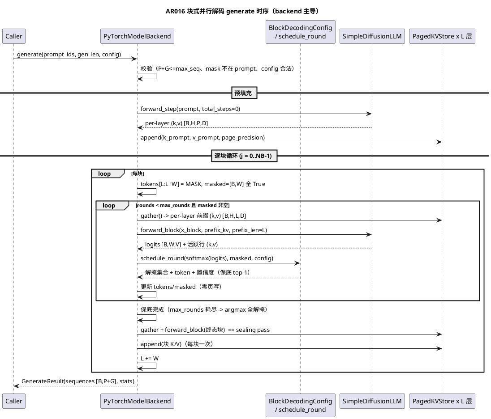
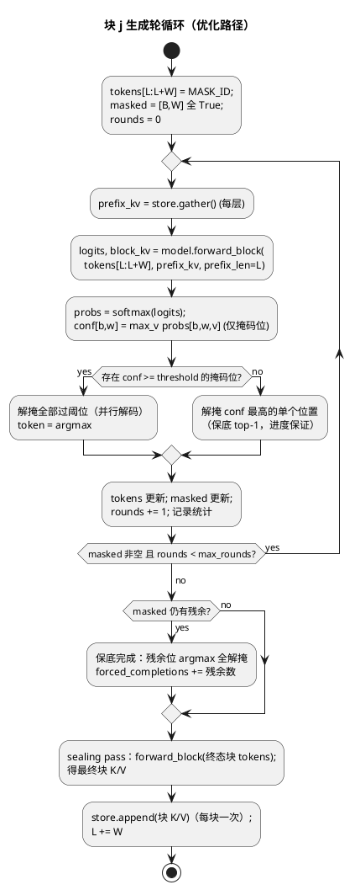

# 1 AR概述

| 组件名称 | ShadowInfer 执行平面（execution / models / core.backends） |
| --- | --- |
| AR系统流水号 | AR016 |
| AR描述 | 置信度感知块式并行解码服务管线：真实块式半 AR 生成环路（Fast-dLLM 对标）+ 块因果注意力协议下的跨块精确前缀 KV 驻留（PagedKVStore 页封存，轮间零页写）。fp32 页 token 轨迹与全量重算 baseline 逐位一致。 |

# 2 动态行为

## 交互时序图



# 3 功能点分解

| 序号 | 功能点名称 | 功能点描述 |
| --- | --- | --- |
| 1 | ConfidenceSchedule | 置信度感知并行解掩：过阈全解掩 + 保底 top-1 + max_rounds 保底完成 + 配置校验（FR16.1） |
| 2 | forward_block | 模型尾块连续活跃前向：per-layer 前缀 KV 条件 attention，返回块 logits + 活跃行 K/V（FR16.2） |
| 3 | 块因果 attention_mask | `forward_step`/`DiffusionTransformerBlock.forward`/`_compute_block` 增可选加性掩码（默认 None 逐位回归）；baseline 臂全量重算用同协议掩码（方案 A 落地） |
| 4 | backend.generate | 预填充 append / 逐块循环 / sealing pass / 封存 append / 轮间零页写 / 精度平面 fp32-fp16-int8 / fail-fast 校验（FR16.3） |
| 5 | 生成统计 | 总量/逐块/派生键恒存在且解析一致（FR16.4） |
| 6 | baseline 参考环路 | `blockwise_generate_baseline`：同调度、每轮全量重算 + 块因果掩码；UT/bench 共享（精确性对照） |
| 7 | 基准与预注册 | 校准探针 -> 断言登记 -> 四臂全量实跑 -> bench-results.md 落档（FR16.5） |
| 8 | GPU 协议与文档 | s11 yaml + server-experiment.md + README 四检查点 + 版本 3.18.0 四处同步（FR16.6） |

# 4 实现设计

## 4.1 功能实现思路

**核心架构决策（方案 A，块因果注意力协议）：** 半 AR 块式生成中，定义服务协议「块内双向、跨块因果」——当前块行可见全部上下文（前缀 + 当前块）；前缀行感受野限定于前缀自身（已封存内容不被当前掩码块扰动）。由此前缀行的 hidden/K/V 在封存后**永不变化** → 前缀 KV 精确（bitwise）复用，无近似、无漂移门、无误差累积。这是相对 Fast-dLLM（dual-cache 近似，余弦≈1）的核心架构差异：**把 KV 缓存从近似工程变成无损协议**。

**三个协议杠杆（exactness 成立条件，两臂一致）：**
1. **块因果掩码**：baseline 全量重算时施加**段因果**加性掩码（见 4.5 erratum：`segment_causal_mask`，`seg(i)=0 if i<P else 1+(i-P)//W`，`mask[i,j]=-inf iff seg(i)<seg(j)`）；优化路径天然满足（仅算活跃行，其感受野即全上下文）；
2. **时间不变条件**：生成协议全程 `total_steps=0`（`forward_step` 现行语义：`total_steps>0` 才加时间嵌入）——K/V 与轮数解耦。真实 dLLM 的替代口径（全程固定 ratio）写入 s11 协议讨论；
3. **封存 sealing pass**：块内最后一个解掩决策产生于「仍有掩码位」的前向，新解掩 token 的终态从未参与前向 → 每块封存前补一次全终态 `forward_block`（W 行），其 K/V 才是该块的最终 KV。

**精确性归纳论证（逐层归纳）**：baseline 在块 j+1 各轮重算块 j 行时，其输入 = 块 j 终态 token、感受野 = [0..L')（块因果掩码排除当前块键）、无时间嵌入 → 与 sealing pass 输入/感受野逐位相同 → 各层 hidden/K/V 逐位相同（逐行算子）；当前块行在两臂中输入/感受野相同 → logits 差异仅剩 attention matmul M 维分块归约序噪声（AR015 T003 实证 relL2 ≈ 7.7e-8）→ UT 容差 1e-6，贪心 token 决策逐位一致。

**计算削减来源**：baseline 每轮全量前向 (L+W) 行（投影+FFN ~24d²/行 + attention (L+W)×(L+W)）；优化路径每轮 W 行 + attention W×(L+W) + 前缀 gather O(L) 读取。行计算削减 ~ (L+W)/W（玩具规模 8-16x）；KV 写行数：baseline 每轮 (L+W)×L 层 vs 优化路径每行一次（P+G 总量）。

## 4.2 功能实现设计

### 4.2.1 流程图



### 4.2.2 流程说明

1. **预填充**：`forward_step(prompt_ids, step_t=0, total_steps=0)`（P 行全量前向，无掩码——P 行互见即「块因果」在首块的平凡情形）；per-layer (k,v) 以 `page_precision` append 入各层 `PagedKVStore`（max_seq = P+G，本层一 store，generate 调用内新建）。
2. **轮循环**：每轮每层 `store.gather()` 取前缀 [B,H,L,D] → `forward_block` 仅对 W 行计算（embed/pos[L:L+W]/无时间嵌入 → 逐层 `_compute_block(hidden_block, kv_cache=prefix)` → 收集活跃行 (k_new,v_new)）→ out_norm/output_proj → logits [B,W,V]。**轮间零页写**：store 仅被 gather 读取，页数/页内容/页 id 不变（UT 断言）。
3. **调度**（`schedule_round`）：逐 batch 元素独立——掩码位置信度 = softmax 最大值；过阈全解掩；无过阈解掩 top-1（保底）；token = argmax。已达 max_rounds 仍有残余 → 残余位按最后 probs argmax 全解掩，计 `forced_completions`。
4. **封存**：sealing pass（全终态 token 的 `forward_block`）→ 块 K/V append 入页（一次性）；L += W；进入下一块。sealing pass 计入 `computed_rows`。
5. **baseline 参考环路**（`blockwise_generate_baseline`，库内共享）：同 Config/同 schedule_round；每轮对 [B, L+W] 全上下文 `forward_step(..., total_steps=0, attention_mask=segment_causal_mask(L+W, L, W))`（段因果，见 4.5 erratum）；取块行 logits 调度；无 store、无 sealing（全量重算语义天然每轮刷新）。两臂共用调度模块保证决策序列同源。
6. **精度平面**：`page_precision` fp32（gather 逐位等于原始 K/V，精确臂）/ fp16 / int8（gather 为反量化值，权衡臂；token 轨迹偏差由基准实测报告）。
7. **fail-fast**：`P + gen_len > max_seq_len`、prompt 含 mask_token_id、mask_token_id >= vocab、`gen_len % block_size != 0`、非法 precision → `ValueError`（带阶段诊断信息）；generate 为批式 API，不做运行中降级（与 forward_step 服务路径的 fallback 语义区分，design §5 无重构）。

## 4.3 接口描述

**新增模块 `shadowinfer/execution/block_decoding.py`：**

```python
@dataclass(frozen=True)
class BlockDecodingConfig:
    block_size: int = 32            # >= 1
    max_rounds: int = 8             # >= 1
    confidence_threshold: float = 0.9  # (0, 1]
    mask_token_id: int = 0          # 生成时校验 < vocab 且不在 prompt
    page_size: int = 32             # >= 1
    page_precision: str = "fp32"    # fp32|fp16|int8
    # __post_init__ 校验非法即 ValueError

@dataclass
class ScheduleDecision:
    unmask: torch.Tensor        # [B, W] bool
    tokens: torch.Tensor        # [B, W] long（解掩位的 argmax token）
    confidences: torch.Tensor   # [B, W] float
    progress_fallback: torch.Tensor  # [B] bool（该轮是否走保底 top-1）

def schedule_round(logits_block, masked, config) -> ScheduleDecision
    # logits_block [B,W,V]；masked [B,W] bool；逐 batch 元素独立

@dataclass
class GenerateResult:
    sequences: torch.Tensor     # [B, P+G] long
    stats: Dict[str, object]

def block_causal_mask(seq_len: int, prefix_len: int, device) -> torch.Tensor
    # [S, S] float 加性掩码：mask[i,j] = -inf iff (i < L) and (j >= L)，否则 0
    # （单尾块情形；多块场景 baseline 用 segment_causal_mask，见 4.5 erratum）

def segment_causal_mask(
    seq_len: int, prefix_len: int, block_size: int, device
) -> torch.Tensor
    # [S, S] float 加性掩码：seg(i) = 0 if i < prefix_len else 1 + (i - prefix_len)//block_size
    # mask[i,j] = -inf iff seg(i) < seg(j)，否则 0（每行感受野封存后时间不变）

def blockwise_generate_baseline(model, prompt_ids, gen_len, config) -> GenerateResult
    # 全量重算参考环路（块因果掩码），UT 与 bench 共享
```

**模型 `SimpleDiffusionLLM`（修改）：**

```python
def forward_step(..., attention_mask: Optional[torch.Tensor] = None)
    # 新可选参（默认 None 逐位回归）；[S,S] 或 [1,1,S,S] 加性掩码，逐层 _compute_block 应用
    # DiffusionTransformerBlock.forward 同步透传

def forward_block(
    self,
    x_block: torch.Tensor,                    # [B, W] token ids 或 [B, W, d] hidden
    prefix_kv: Dict[int, Tuple[Tensor, Tensor]],  # 每层 [B, H, L, D]
    prefix_len: int,                          # L >= 0
    step_t: int = 0,
    total_steps: int = 0,                     # 生成协议固定 0（无时间嵌入）
) -> Tuple[torch.Tensor, Dict[int, Tuple[Tensor, Tensor]]]
    # 返回 (logits [B, W, vocab], block_kv 每层活跃行 (k,v) [B,H,W,D])
    # 内部复用 _compute_block(hidden_block, kv_cache=(prefix_k, prefix_v))——活跃行天然块因果
```

**后端 `PyTorchModelBackend`（新增方法）：**

```python
def generate(
    self,
    prompt_ids: torch.Tensor,     # [B, P] long
    gen_len: int,                 # G，% block_size == 0
    config: BlockDecodingConfig,
) -> GenerateResult
    # 预填充 -> 逐块循环 -> sealing/封存 -> 统计；PagedKVStore 按层驻留
```

**与既有系统的关系：** orchestrator 零改动（generate 为 backend 直连批式 API）；`configure_execution` 各执行模式与 generate 互不影响（generate 内自建 store，不动 forward_step 服务路径状态）。

## 4.4 代码设计

```
shadowinfer/
├── execution/
│   ├── block_decoding.py        # 新增：Config/ScheduleDecision/schedule_round/
│   │                            #       block_causal_mask/GenerateResult/stats 累计器/
│   │                            #       blockwise_generate_baseline
│   └── __init__.py              # 导出新符号
├── models/
│   └── simple_diffusion_llm.py  # forward_block 新增；forward_step/block.forward/
│                                # _compute_block 增可选 attention_mask（默认 None）
├── core/backends/
│   └── pytorch_backend.py       # generate 方法 + 校验 + 统计装配
└── shadowkv/
    └── paged_kv_store.py        # 零改动（append/gather/precision 语义沿用 AR014/AR015）

tests/test_block_decoding.py     # 新增：T001-T005 全部 UT
specs/changes/AR016-blockwise-parallel-decoding/ar016_bench.py
configs/experiments/s11_blockwise_decoding_gpu.yaml
```

模块化要点：调度（纯函数，无状态）与前向（模型）与驻留（store）与管线（backend）四层解耦；baseline 环路与优化环路共享 Config/schedule_round/掩码构造——两臂差异仅在前向平面（全量重算 vs 前缀条件活跃行），精确性对照同源可证。

# 5 重构设计

无既有代码重构。`forward_step`/`DiffusionTransformerBlock.forward`/`_compute_block` 仅增可选参数 `attention_mask`（默认 None，行为逐位不变，全量回归证明）；`_compute_block` 返回签名不变（AR015 已定形）。

## 4.5 Erratum：段因果掩码（2026-10-22，T005 开发中发现）

**缺陷：** 原掩码公式 `mask[i,j] = -inf iff (i < L) and (j >= L)`（L 为当前前缀长）在**多块**场景下与方案 A 自身前提矛盾：block j 轮次时 L = P + jW，prompt 行（i < P < L）可见列 j' < L——**包含已封存的块 0..j-1**；而 generate 臂的 prompt KV 在预填充时仅见过 prompt。即前缀行感受野随前缀增长而变化，前缀 KV 并非时间不变，bitwise 复用前提被破坏。T005 实测证据：两臂 block-0 轮 logits 逐位一致（relL2=0），block-1 轮 logits relL2 恒定 5.2e-3；逐层定位：layer-0 K 逐位一致（投影行独立于 attention），layer-1 prompt K 最大差 0.1（layer-0 attention 上下文不同：prompt-only vs prompt+block0）。

**修正（与方案 A 意图一致，唯一自洽解）：** 引入段因果掩码 `segment_causal_mask(seq_len, prefix_len, block_size)`：`seg(i) = 0 if i < P else 1 + (i - P) // W`，`mask[i,j] = -inf iff seg(i) < seg(j)`。每行感受野封存后时间不变（prompt 行恒见 prompt；块 j 行恒见 prompt+块 0..j），baseline 在上下文内重算的前缀行 KV 与 generate 臂封存值 bitwise 一致。单尾块情形（S = P + W）与原公式逐位一致，故 `block_causal_mask` 保留原语义（T002 单块 UT 不变），baseline 环路改用 `segment_causal_mask`。T002 掩码语义测试（前缀行 == 前缀-only 前向）在段因果下依然成立（单块即段因果的特例）。

# 6 测试设计

## 6.1 单元测试（UT）

- **T001 ConfidenceSchedule**（FR16.1）：构造 logits 下过阈并行解掩/未过阈保持；全低于阈 → 恰好 top-1；argmax token 正确；batch 元素独立（A 解掩不影响 B）；配置校验五类 ValueError；退化输入（空 logits）显式报错。
- **T002 forward_block + attention_mask**（FR16.2 + 功能点 3）：同一上下文下 forward_block vs forward_step(块因果掩码)：块行 logits relL2 <= 1e-6（fp32）、活跃行 k/v 逐位相等；`prefix_len=0` 与全量前向一致；`attention_mask=None` 逐位回归（v3.17.0 锚点）；掩码正确性：baseline 前缀行输出 == 前缀-only 前向（逐位）；形状不符/层数不符 ValueError。
- **T003 backend.generate 管线**（FR16.3）：页驻留行为——预填充/封存各 append 一次、轮间 page_count 与页 id 不变（零页写）、`appended_tokens == P+G`；fp32/fp16/int8 三精度全流程完成；fail-fast 校验（超长/prompt 含 mask/gen_len 不整除/非法 precision）。
- **T004 统计**（FR16.4）：八类键恒存在；`computed_rows == Σ(W×(rounds+1))`（含 sealing）、`kv_write_rows == P+G`、`rounds_per_block`/`forced_completions` 与解析预期一致；`rows_saved_vs_baseline` 正确。
- **T005 e2e 精确性**（FR16.3 验收）：fp32 臂 `generate` vs `blockwise_generate_baseline`：sequences 逐位一致（多块/多规模/B=2/含保底完成路径）；逐步块行 logits relL2 <= 1e-6；fp16 臂正常完成且统计含精度标识。

## 6.2 接口测试

`generate` 签名与返回契约（GenerateResult 字段/形状/dtype）；`forward_block` 输入两种形态（token ids / hidden）；`block_causal_mask` 形状与取值枚举核验；`BlockDecodingConfig` 默认值与校验消息。

## 6.3 业务场景测试

- 受控生成任务：随机 prompt（seed 固定）+ 多块生成，全程真实前向；置信度轨迹与解掩进度单调（掩码数不增）；
- 精确性场景：fp32 两臂 token 序列逐位一致（核心验收场景）；
- 精度权衡场景：fp16/int8 臂完成度与偏差实测（基准量化）；
- 性能场景：computed_rows/kv_write_rows 削减与端到端加速（基准量化）。

## 6.4 异常场景测试

- 配置非法（五类）→ configure/generate 阶段 ValueError（fail-fast，无半执行状态）；
- prompt 含 mask_token_id / 超长 / gen_len 不整除 → ValueError 且 store 未创建或为空（无副作用）；
- 形状/层数不符 → forward_block ValueError；
- 保底路径：max_rounds=1 强制走保底完成与 forced_completions 记账；保底 top-1 在首个轮即触发（构造全低置信 logits）不死循环。

## 6.5 基准测试（T006，`ar016_bench.py`）

- 四臂：**baseline**（`blockwise_generate_baseline`，全量重算）/ **blockwise-fp32**（精确臂）/ **blockwise-fp16** / **blockwise-int8**；真实 `SimpleDiffusionLLM`，真实随机 prompt，`torch.set_num_threads(1)`，3 seeds（0/1/2）。
- 规模：(L,H,D) 固定 (8,8,64)，P=64，G=192/448/960（S=256/512/1024，块数 6/14/30，W=32）；B=2；`max_rounds=8`、`confidence_threshold=0.9`。
- 指标：端到端总时间、逐块耗时中位、`computed_rows`、`kv_write_rows`、fp32 臂逐步 logits relL2 与 token 序列一致性、fp16/int8 臂 relL2 与 token 一致率。
- **校准先行**（AR015 纪律）：正式断言登记前跑校准探针（不入库），按实测固化阈值（裕量 >= 20%），断言集跑前登记于本文件与 bench-results.md；未达标如实报告（三轮预注册历史模式沿用）。
- 初步预期（待校准确认，不构成预注册）：fp32 token 逐位一致 + relL2 <= 1e-6；端到端加速 >= 3x（至少 2 规模点）；`kv_write_rows` 削减 >= 5x；fp16/int8 token 一致率与 relL2 实测报告口径。
