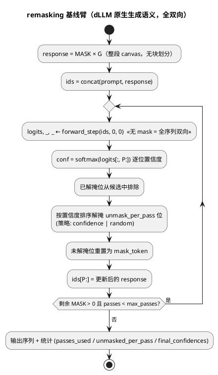
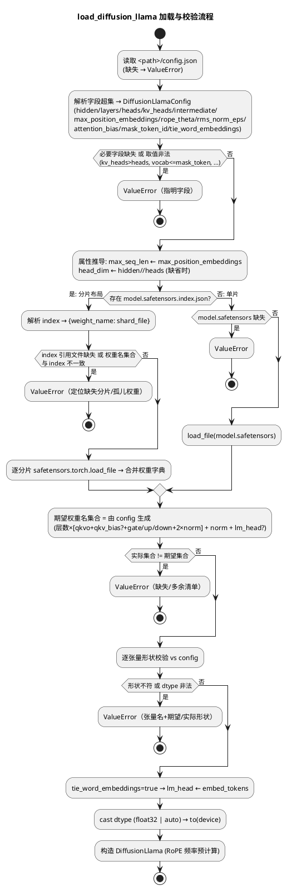

# 1 AR概述

| 组件名称 | shadowinfer（models 模型层 / execution 编排层 / core.backends 装配层） |
| --- | --- |
| AR系统流水号 | AR018 |
| AR描述 | 真实 dLLM 权重执行平面：自研 DiffusionLlama（Llama/Qwen 架构 + 双向/段因果 attention + GQA + RoPE + RMSNorm + SwiGLU + mask token），直接加载真实 LLaDA-8B / Dream-7B checkpoint（config.json + safetensors 单片/分片），实现 AR016/017 块式管线契约并接入全管线（mask-init / draft-verify 两模式），新增 dLLM 原生 remasking 基线臂。方案 A：KV 原生 GQA 页存储（7B 下省 4-8 倍页内存）+ generate 编排抽取为 execution 层纯函数（两臂对称，单一实现）。s12 悬置的 S1-S3 场地断言移交 s13 服务器协议判定。 |

# 2 动态行为

## 交互时序图

```plantuml
@startuml
title DiffusionLlama 块式生成时序（真实权重执行平面，方案 A）
participant Load as load_diffusion_llama\n(diffusion_llama.py)
participant Model as DiffusionLlama
participant Gen as blockwise_generate\n(纯函数, execution 层)
participant Store as PagedKVStore (per-layer)\n[num_kv_heads 原生]
participant Sched as block_decoding\n(调度纯函数, 零改动)

Load -> Load : 解析 config.json (Llama/Qwen 字段超集)
Load -> Load : safetensors 单片/分片加载\n+ 命名映射 + 形状校验
Load -> Model : 构造 (权重 cast dtype, RoPE 频率预计算)

Gen -> Model : forward_step(prompt_ids, 0, 0)  «prefill, 无 mask = prompt 内全双向»
Model --> Gen : (logits, kv {layer:(k,v) [B,H_kv,P,D]}, None)
Gen -> Store : append(kv, fp32)  «每层一次, P 行»
loop 逐块 (G/W 个块)
  Gen -> Store : gather() -> prefix_kv [B,H_kv,L,D]
  Gen -> Model : forward_block(block_tokens, prefix_kv, L)
  Model -> Model : repeat_kv 展开 (attention 内部, 瞬时)
  Model --> Gen : (logits [B,W,V], block_kv [B,H_kv,W,D])
  Gen -> Sched : schedule_round / draft_round / verify_round\n(机制零改动)
  Gen -> Store : append(封存 block_kv)  «每层一次, W 行»
end
Gen --> Gen : GenerateResult (17 键 stats) + stores
@enduml
```



# 3 功能点分解

| 序号 | 功能点名称 | 功能点描述 | 追溯 |
| --- | --- | --- | --- |
| 1 | checkpoint 加载器 | config.json 解析（Llama/Qwen 字段超集、mask_token_id、attention_bias、max_position_embeddings→max_seq_len fail-fast）+ safetensors 单片/分片 + 命名映射 + tie_word_embeddings + dtype 可配 + fail-fast | FR18.1 |
| 2 | DiffusionLlama 建模层 | RMSNorm/RoPE(任意 theta+位置偏移)/SwiGLU/GQA(repeat_kv)/三态 mask（全双向/段因果/块行条件）+ 手写参考 golden 数值对照 | FR18.2 |
| 3 | 管线契约 | 属性六件+num_kv_heads；forward_step 三元组（kv_cache 显式拒绝）；forward_block 二元组（KV 头原生口径）；段因果分解两级锚点（KV 逐位 + logits 容差 + argmax 等价） | FR18.3 |
| 4 | generate 抽取与接入 | blockwise_generate 纯函数（编排逻辑迁移零语义改动）；PyTorchModelBackend.generate 薄委托；GQA 原生 store 装配（getattr num_kv_heads 默认） | FR18.3 |
| 5 | remasking 基线臂 | 独立模块：全序列重算 + 低置信重掩 + 步长可配策略 + 独立统计与校验 | FR18.4 |
| 6 | fixture 生成器与预设 | fixture_gen.py 参数化真实格式生成（单片/分片/两 style/GQA/MHA/tie/bias）；PRESETS 文献口径登记（dream-7b/llada-8b） | FR18.5 |
| 7 | s13 协议 + EXPERIMENTS.md + serve_arm | s13 yaml 四臂 + 独立服务器手册 + 新建 serve_arm.py --model（归档零改动） | FR18.6 |
| 8 | README + 版本同步 | 四检查点（零性能主张，s13 回填占位）+ v3.20.0 四处 | FR18.7 |

# 4 实现设计

## 4.1 功能实现思路

**方案 A（用户定案）：KV 原生 GQA 页存储 + generate 编排抽取为纯函数 + remasking 独立模块。**

关键设计决策（含 srs 移交定案）：

- **D1 GQA 原生存储**：`PagedKVStore` 构造传 `num_kv_heads`（7B 真跑页内存省 4-8 倍：LLaDA-8B 8→32 头、Dream-7B 4→28 头）；`repeat_kv` 展开只发生在模型 attention 计算内部（瞬时激活，不驻留页）；`PagedKVStore` 公开 API 与页布局零改动（构造参数传不同值属既有 API 使用）。
- **D2 H_* 口径定案（srs FR18.3 移交）**：**KV 头原生数**。`forward_step` 返回的 kv 与 `forward_block` 返回的 block_kv、页 gather 出的 prefix_kv 全部为 `[B, num_kv_heads, T, D]` 原生口径；同一模型内全部层一致；Q 头展开仅在 attention score 计算处（`repeat_kv(k, n_rep)` 后与 q 相乘）。MHA（`num_kv_heads == num_heads`）时 `repeat_kv` 为恒等，零特判。
- **D3 generate 抽取**：`pytorch_backend.py::generate` 的编排体（预填充/块循环/调度分支/封存/统计，AR016+AR017 全部逻辑）整体迁移为 `shadowinfer/execution/blockwise_generate.py::blockwise_generate(model, prompt_ids, gen_len, config, capture_block_logits=False) -> Tuple[GenerateResult, Dict[int, PagedKVStore]]`。**逻辑零改动**（cut-paste + import 调整）；`PyTorchModelBackend.generate` 变薄委托（调纯函数、`_last_generate_stores` 语义不变）；`GenerateResult` 公开结构零改动（stores 走返回 tuple，不进 dataclass）。与既有 `blockwise_generate_baseline` 纯函数形态对称，serve_arm/测试直接函数级调用。
- **D4 模型协议**：`block_decoding.py` 的 `model: SimpleDiffusionLLM` 注解放宽为 `BlockwiseModel`（TYPE_CHECKING Protocol：属性 + forward_step/forward_block）；运行时鸭子类型零开销。store 装配处 `num_kv_heads = getattr(model, "num_kv_heads", model.num_heads)`——SimpleDiffusionLLM 无此属性 → 取 num_heads，**MHA 路径零行为差异**（模型文件零触碰）。
- **D5 三态 mask 语义**（诚实口径三分类）：
  - **(a) 全双向**（dLLM 原生）：remasking 臂与 prefill 用全零加性 mask（等价无 mask）——response 各位可见全部 prompt 与 response 位（含"未来"位）；
  - **(b) 段因果**（块式半 AR 近似族，Fast-dLLM 同族）：复用 `block_decoding.segment_causal_mask`（函数零改动直接 import）——prompt 行恒见 prompt、块 j 行见 prompt+块 0..j；
  - **(c) 块行条件**（(b) 的精确优化计算）：`forward_block` 只算块行、以冻结 prefix_kv 为条件——q 行天然只对 [prefix+block] keys 计算，无需显式 mask。
  - 口径声明：块式臂 (b)/(c) 是 (a) 的半 AR 近似（早期块不可见后期块），与 remasking 臂的一致率（S3）是一等指标，文档不伪称等价。
- **D6 RoPE**：标准 rotate-half 实现；`inv_freq = theta^(-2i/d)` 预计算缓存（按 (theta, head_dim, device, dtype) 键）；位置 = 绝对索引，`forward_block` 块行位置 `[prefix_len, prefix_len+W)`（与 forward_step 中同行位置一致——分解锚点的前提）；`rope_theta` 完全 config 驱动（Llama-3 口径 500000 / Qwen2.5 口径 1000000，无硬编码）。
- **D7 段因果分解两级锚点**：fp32 下 `forward_step(full_ids, 0, 0, attention_mask=segment_causal_mask(...))` 输出的块行结果与 `forward_block(block_rows, prefix_kv, L)` 输出按两级断言：(i) **KV 投影逐位一致**（`torch.equal`——row-local 计算，跨形状逐位成立，沿 test_block_decoding.py 既有先例）；(ii) **块行 logits 相对 L2 容差对照**（fp32，容差登记，沿 FB_TOL=1e-6 先例）+ argmax 决策等价（生成序列逐位）作端到端强锚点。同构条件：两条路径对块行的算子序列完全同构（embedding → 逐层 [rmsnorm → q/k/v proj → rope → repeat_kv → scores=q@cat(prefix_k,block_k)^T → softmax → @cat(prefix_v,block_v) → o_proj → 残差 → rmsnorm → SwiGLU → 残差] → final norm → lm_head），设计上强制 forward_block 内部按此顺序实现；**同构保证容差紧致与 KV 逐位，不保证 logits 逐位**——attention score matmul 形状差异（`[S,d]@[d,S]` vs `[W,d]@[d,L+W]`）在 CPU GEMM 下引入归约顺序噪声，仓库 fp32 实证已否证逐位（test_block_decoding.py 注释明示 "not bitwise"），AR016 同源锚点即容差口径。
- **D8 remasking 独立模块**：`shadowinfer/execution/remasking.py`（不触碰 block_decoding.py 机制文件）。`RemaskingConfig(mask_token_id, unmask_per_pass, max_passes, strategy)`，`strategy ∈ {confidence, random}`（confidence = softmax 最大值排序解掩，LLaDA low-confidence remasking 口径；random 为文献对照策略）；独立 fail-fast（gen_len 无整除约束——非块式；prompt 含 mask / mask_token_id 越界 / 超长 沿用同口径）；独立统计键集（passes_used/unmasked_per_pass/final_confidences/mask_residuals——**不属于 17 键契约**，独立臂独立口径，文档明示）。
- **D9 权重命名单一映射**：Llama 与 Qwen2.5 的权重命名**同构**（`model.layers.N.self_attn.{q,k,v,o}_proj.weight[+bias]`、`model.layers.N.mlp.{gate,up,down}_proj.weight`、`model.layers.N.{input,post_attention}_layernorm.weight`、`model.norm.weight`、`lm_head.weight`），单一映射表覆盖两 style；style 差异在 config 字段（Qwen `attention_bias=true` → q/k/v 带 bias；Llama 全无 bias）与 `tie_word_embeddings` 取值，均由 config 驱动加载。
- **D10 dtype**：`dtype="float32"`（默认，本地与数值锚点口径）或 `"auto"`（随 checkpoint bf16 原样，s13 GPU 口径）；参数 cast 后 `.to(device)`；KV/激活 dtype 跟随参数。
- **D11 kv_cache 显式拒绝**：`forward_step(..., kv_cache=...)` 非 None → `ValueError`（dLLM 块式平面不支持 AR 式增量 KV serving 语义，显式拒绝优于静默忽略）；`step_t/total_steps` 接受但忽略（管线兼容占位，docstring 明示）。
- **D12 零 mock 加载路径**：fixture_gen 写真实文件 → `load_diffusion_llama` 读真实文件——测试与 s13 真实权重走**同一代码路径**，无内存捷径。
- **D13 PRESETS 文献口径登记**：`PRESETS = {"dream-7b": {...}, "llada-8b": {...}}` 常量表（见 4.2.2 表；标注"文献口径，s13 服务器以真实 config.json 核实，出入则 erratum 落档"）；fixture 生成独立参数化（tiny 尺寸），PRESETS 供 EXPERIMENTS.md 引用与核实对照；**代码零硬编码**（全部 config 驱动，PRESETS 仅文档/断言对象，不进加载路径）。
- **D14 serve_arm 新建**：`specs/changes/AR018-real-dllm-weights/serve_arm.py`（复制扩展 AR017 归档版，归档零改动）；`--model <path>` → `load_diffusion_llama`；`--arm {baseline, mask-init, draft-verify, remasking}` 四值。
- **D15 max_seq_len**：`max_position_embeddings`（两命名同名）→ 模型属性 `max_seq_len`；RoPE 频率缓存按其预计算；字段缺失 fail-fast（错误消息含字段名）。

## 4.2 功能实现设计

### 4.2.1 流程图



### 4.2.2 流程说明

1. **加载（FR18.1）**：见上图。期望权重名集合由 config **推导**（非硬编码清单），逐层校验 `{q,k,v,o}_proj`（+bias 当 `attention_bias=true`）、`mlp.{gate,up,down}`、双 layernorm、`model.norm`、`lm_head`（tie 时缺省合法，加载时以 embed 权重共享引用）。异常路径零部分加载：全部校验先于模型构造，失败时无任何状态产生。

2. **建模层前向（FR18.2）**：单层计算序（D7 同构约束）：
   `h = x + o_proj(attn(rmsnorm(x)))`，`attn = softmax(q·repeat_kv(k)^T/√d + mask)·repeat_kv(v)`，q/k/v 位置经 RoPE；`h = h + down(silu(gate(h)) × up(h))`（SwiGLU）；
   全双向/段因果 = 加性 mask 广播 `[1,1,S,S]`（接受 `[S,S]` 或 `[1,1,S,S]`，沿 SimpleDiffusionLLM 口径）；块行条件 = forward_block 内部 `k_full = cat(prefix_k, block_k)` 显式拼接（无 mask）。

3. **PRESETS 文献口径表（D13，待 s13 核实）**：

| 字段 | dream-7b（Qwen2.5-7B 初始化口径） | llada-8b（LLaMA-3-8B 初始化口径） |
|---|---|---|
| num_hidden_layers | 28 | 32 |
| hidden_size | 3584 | 4096 |
| num_attention_heads | 28 | 32 |
| num_key_value_heads | 4 | 8 |
| head_dim | 128 | 128 |
| intermediate_size | 18944 | 14336 |
| vocab_size | 151936 | 126464 |
| mask_token_id | 151669 | 126336 |
| max_position_embeddings | 131072（Qwen2.5 口径） | 8192 |
| rope_theta | 1000000.0 | 500000.0 |
| rms_norm_eps | 1e-6 | 1e-5 |
| attention_bias | true | false |
| tie_word_embeddings | false | false |

   > 文献口径登记（2026-10-24）：本机网关拦截 HF/arXiv/GitHub 全部通道无法核实（用户确认）；s13 服务器下载权重时以真实 config.json 核实，任何出入在本表与 design.md 落 erratum，代码 config 驱动不受影响。

4. **generate 纯函数（FR18.3，D3）**：迁移后 `blockwise_generate` 与 `blockwise_generate_baseline` 同层对称；`validate_generate_inputs` 留守 `block_decoding.py`（baseline 与纯函数共同 import，零改动）；store 装配改用 D4 的 `getattr` 取 kv 头数；其余逐行保持（调度调用、封存、统计、fail-fast 清单、`_last_generate_stores` 语义经薄委托保持）。

5. **remasking 循环（FR18.4，D8）**：见 §2 第二图。已解掩位从候选排除（`candidate_mask` 累积）；`strategy=confidence` 按位 softmax 最大值排序取 top-`unmask_per_pass`（并列取最小位置，确定性惯例）；`random` 用 torch 生成器显式种子（可复现）；终止条件：无剩余 MASK 或 `max_passes` 耗尽（残余 MASK 如实计入 `mask_residuals`，不静默截断）。

6. **fixture_gen（FR18.5）**：参数化 CLI + Python API（`generate_fixture(out_dir, *, style, num_layers, num_heads, num_kv_heads, head_dim, vocab_size, mask_token_id, max_position_embeddings, rope_theta, rms_norm_eps, attention_bias, tie_word_embeddings, intermediate_size, sharded, shard_size, dtype, seed)`）；权重 = 固定种子 `torch.randn`/`randint` 真实 safetensors 落盘（`safetensors.torch.save_file`，单片或分片+index）；config.json 按目标字段全集序列化；`sharded=True` 时按张量名排序贪心分片、index 记录映射。测试经 Python API 在 `tmp_path` 生成（真实 IO）。

7. **GQA 展开一致性**：`repeat_kv` 单一实现（`expand → reshape → repeat`），forward_step 与 forward_block 共用（D7 锚点的组成）；展开仅作用于 attention 计算内，kv 字典出口恒原生口径（D2）。

### 4.3 接口描述

**新增公开 API（`shadowinfer/models/diffusion_llama.py`，经 `models/__init__.py` 导出）：**

```python
@dataclass(frozen=True)
class DiffusionLlamaConfig:
    vocab_size: int
    hidden_size: int
    num_hidden_layers: int
    num_attention_heads: int
    num_key_value_heads: int
    intermediate_size: int
    max_position_embeddings: int
    rope_theta: float = 10000.0
    rms_norm_eps: float = 1e-5
    head_dim: Optional[int] = None        # 缺省 hidden // heads
    attention_bias: bool = False
    mask_token_id: Optional[int] = None
    tie_word_embeddings: bool = False

def load_diffusion_llama(
    path: str, dtype: str = "float32", device: str = "cpu",
) -> DiffusionLlama:
    """从本地 HF 格式目录加载（config.json + safetensors 单片/分片）。

    Raises:
        ValueError: 目录/文件缺失、字段缺失或非法（含 max_position_embeddings
            fail-fast）、权重缺失/多余/形状不符、分片 index 不一致、
            mask_token_id 词表越界。
    """

class DiffusionLlama(nn.Module):
    # 属性契约（块式管线视角）
    num_layers: int                       # = num_hidden_layers
    num_heads: int                        # = num_attention_heads（Q 头）
    num_kv_heads: int                     # = num_key_value_heads（D2 原生口径）
    head_dim: int
    max_seq_len: int                      # = max_position_embeddings（D15）
    vocab_size: int
    device: torch.device
    mask_token_id: Optional[int]          # config 透传，可为 None
    config: DiffusionLlamaConfig

    def forward_step(self, x, step_t, total_steps,
                     kv_cache=None, attention_mask=None):
        """全序列前向（prefill / 全序列重算 / remasking 臂）。

        Returns:
            (logits [B,S,V], kv {layer: (k,v) [B,num_kv_heads,S,D]}, None)
        Raises:
            ValueError: kv_cache 非 None（D11 显式拒绝）；x 非法；
                attention_mask 形状非 [S,S]/[1,1,S,S]。
        注: step_t/total_steps 接受但忽略（dLLM 无 timestep 语义）。
        """

    def forward_block(self, x_block, prefix_kv=None, prefix_len=0,
                      step_t=0, total_steps=0):
        """块行条件前向（D5(c)）：只算尾 W 行，冻结 prefix_kv 条件。

        Returns:
            (logits [B,W,V], block_kv {layer: (k,v) [B,num_kv_heads,W,D]})
        Raises:
            ValueError: prefix_kv 缺层/形状不符 [B,num_kv_heads,prefix_len,D]
                （沿 SimpleDiffusionLLM.forward_block 校验口径）。
        """

PRESETS: Dict[str, Dict[str, Any]]       # D13 文献口径表（文档/断言对象）
```

**新增编排纯函数（`shadowinfer/execution/blockwise_generate.py`，经 `execution/__init__.py` 导出）：**

```python
def blockwise_generate(
    model, prompt_ids, gen_len, config,
    capture_block_logits: bool = False,
) -> Tuple[GenerateResult, Dict[int, PagedKVStore]]:
    """AR016/017 generate 编排的纯函数形态（D3 迁移，逻辑零改动）。

    model 需满足 BlockwiseModel 协议（D4）；GQA 模型 store 以
    num_kv_heads 构造（getattr 默认 num_heads，MHA 零差异）。
    """
```

**新增 remasking 模块（`shadowinfer/execution/remasking.py`，经 `execution/__init__.py` 导出）：**

```python
@dataclass(frozen=True)
class RemaskingConfig:
    mask_token_id: int
    unmask_per_pass: int
    max_passes: int
    strategy: str = "confidence"          # "confidence" | "random"

def remasking_generate(model, prompt_ids, gen_len, config,
                       generator: Optional[torch.Generator] = None,
                       ) -> GenerateResult:
    """dLLM 原生生成基线臂（D5(a) 全双向语义）。

    Returns:
        GenerateResult（stats 独立键集：passes_used / unmasked_per_pass /
        final_confidences / mask_residuals——不属于 17 键契约，D8）。
    Raises:
        ValueError: prompt 2-D 整型、gen_len >= 1、P+G<=max_seq_len、
            mask_token_id ∈[0,vocab)、prompt 不含 mask、unmask_per_pass>=1、
            max_passes>=1、strategy 合法。
    """
```

**既有 API 语义保持（签名不变）**：`PyTorchModelBackend.generate`（薄委托 D3，`_last_generate_stores` 语义不变）；`blockwise_generate_baseline` / `segment_causal_mask` / `schedule_round` / `draft_round` / `verify_round` / `validate_generate_inputs` / `BlockDecodingConfig` / `PagedKVStore` 全部零改动（前者仅类型注解放宽，D4）。

**s13 资产**：`configs/experiments/s13_real_dllm_gpu.yaml`（四臂：remasking-baseline / mask-init / draft-verify /（可选 AR 参考）+ model_weights/mask_token_id/块宽/max_rounds/unmask_per_pass 可配 + S1-S3 判定口径）；`EXPERIMENTS.md`（权重获取、环境、命令、取证、落档模板、诚实纪律）；`serve_arm.py` 新建（D14：--model + --arm 四值）。

### 4.4 代码设计

```
shadowinfer/
├── models/
│   ├── diffusion_llama.py        # 新增：DiffusionLlamaConfig / 加载器 /
│   │                              #  DiffusionLlama（RMSNorm/RoPE/SwiGLU/GQA/
│   │                              #  三态 mask）/ PRESETS（~550 行）
│   └── __init__.py               # 导出（SimpleDiffusionLLM 等已有导出零改动）
├── execution/
│   ├── blockwise_generate.py     # 新增：generate 编排纯函数（D3 迁移）
│   ├── remasking.py              # 新增：remasking 臂（~200 行）
│   ├── block_decoding.py         # 类型注解放宽（D4，机制零改动）
│   └── __init__.py               # 导出 blockwise_generate / remasking_generate /
│                                  #  RemaskingConfig（既有导出零改动）
├── core/backends/
│   └── pytorch_backend.py        # generate 变薄委托（D3，~200 行 → ~15 行）；
│                                  # store 装配随迁至纯函数（getattr kv_heads）
tests/
└── test_diffusion_llama.py       # 新增（五分区，见 6.1）
configs/experiments/
└── s13_real_dllm_gpu.yaml        # 新增
EXPERIMENTS.md                    # 新增（仓库根）
specs/changes/AR018-real-dllm-weights/
├── fixture_gen.py                # 新增（测试基建，D12）
└── serve_arm.py                  # 新增（D14，复制扩展 AR017 归档版）
```

- **分层不变**：models 层（权重与前向）不 import execution；execution 层编排经协议消费模型（TYPE_CHECKING 守卫）；backend 层只做委托与状态保持；机制文件（block_decoding.py 调度/统计）零语义改动；
- **无循环导入**：blockwise_generate.py → block_decoding.py + shadowkv + models 无（协议 TYPE_CHECKING）；remasking.py 仅 torch + structs；
- **MHA 回归锚点**：`getattr` 默认路径使 SimpleDiffusionLLM 全部 1214 用例零改动通过（bit-identity 由 T008 全量套件取证）。

# 5 重构设计

**唯一重构：generate 编排抽取（D3）。**

- **范围**：`pytorch_backend.py::generate` 方法体 → `execution/blockwise_generate.py::blockwise_generate` 纯函数；依赖 import（PagedKVStore/调度纯函数/mask 工具/校验）随迁；`_last_generate_stores` 相关私有状态留在 backend（薄委托内赋值）。
- **必要性**：DiffusionLamba 接入 generate 需要不依赖 backend 构造路径（backend.load 是 SimpleDiffusionLLM 专用）的调用形态；复制编排会产生双实现分歧风险（方案 B/C 已否决）；纯函数形态与 baseline 臂对称。
- **回归保障**：cut-paste 零逻辑改动 + 1214 用例逐位回归（含 draft-verify/mask-init 全部既有锚点）+ mypy/flake8 门禁；`_last_generate_stores` 语义与 expose 路径（`last_generate_stores` property）逐字保持。

# 6 测试设计

## 6.1 单元测试（UT）

`tests/test_diffusion_llama.py`，五分区（fixture 经 `fixture_gen.generate_fixture` 在 `tmp_path` 真实 IO 生成，D12）：

- **P1 加载器（FR18.1/T002）**：单片/分片两布局加载；llama/qwen 两 style（attention_bias true/false、tie true/false 四组合）；属性逐项一致（含 max_seq_len ← max_position_embeddings、num_kv_heads、mask_token_id）；权重同 dtype 回读 bitwise；分片 index 与单片结果 bitwise 一致；异常清单：目录缺失/config 缺失/必要字段缺失（错误消息含字段名）/mask_token_id 越界/max_position_embeddings 缺失 fail-fast/权重缺失+多余（清单定位）/形状不符/分片 index 引用缺失文件/孤儿分片/零部分加载（失败后无对象产生）。
- **P2 建模层数值对照（FR18.2/T003）**：手写参考实现（test 内联逐算子：RMSNorm/RoPE/SwiGLU/repeat_kv attention，显式循环慢速版）golden 对照，fp32、atol=rtol=1e-5 登记；对照矩阵 = 三态 mask {全双向, 段因果, 块行条件} × {GQA, MHA} × {rope 偏移 0, 非 0}；段因果分解两级锚点（D7：KV 投影 `torch.equal` 逐位 + 块行 logits rel-L2 容差（登记容差，沿 FB_TOL=1e-6 先例）+ argmax 决策等价）；RoPE 数学性质（相邻位置旋转角差 = theta^(-2i/d)）。
- **P3 契约与管线（FR18.3/T004）**：属性契约完整；forward_step 返回三元组结构与形状（kv 原生 H_kv 口径）；kv_cache 非 None → ValueError；attention_mask [S,S]/[1,1,S,S] 双口径广播；forward_block 契约（logits [B,W,V] + block_kv 原生口径 + prefix_kv 校验异常）；`blockwise_generate` 两模式（mask-init/draft-verify）DiffusionLlama fixture 跑通：17 键统计契约、页驻留不变量（轮间零页写、append P+G 各一次、store 以 num_kv_heads 构造核验 `validate_against`）、序列形状与 prompt 逐位保留；fail-fast 清单（沿 AR016/17：超长/prompt 含 mask/mask 越界/gen_len 不整除）；**MHA 回归**：SimpleDiffusionLLM 经新纯函数跑既有 draft-verify/mask-init 场景与 v3.19.0 逐位一致（抽取重构锚点）。
- **P4 remasking（FR18.4/T005）**：confidence 策略有限步全解掩（无 mask 残留、mask_residuals==0）；已解掩位不再变更（单调性）；unmasked_per_pass 逐轮记账闭式（min(unmask_per_pass, 剩余)）；random 策略生成器种子可复现；max_passes 耗尽 residual 如实记账；batch 元素独立；异常清单（独立校验全项）；remasking vs 块式臂同 prompt 一致率可计算（对照指标存在性，非数值门槛）。
- **P5 fixture 与预设（FR18.5/T001）**：generate_fixture 固定种子两次生成文件 bitwise 一致；sharded 布局 index 完备性（映射覆盖全部权重名、无重叠）；PRESETS 两键字段齐全且内部自洽（heads×head_dim==hidden、kv_heads<=heads、mask_token_id<vocab）——文献口径断言，核实后修订处 erratum。

## 6.2 接口测试

`models/__init__`/`execution/__init__` 导出名可达；`load_diffusion_llama`/`blockwise_generate`/`remasking_generate` 签名与返回契约（Tuple 形状、GenerateResult 结构不变）；`RemaskingConfig` 校验消息；`PyTorchModelBackend.generate` 薄委托行为等价（同输入与纯函数结果 bitwise 一致 + `last_generate_stores` 非空）。

## 6.3 业务场景测试

- 四臂同 prompt 对照：DiffusionLlama fixture 上 remasking / baseline（blockwise_generate_baseline）/ mask-init / draft-verify 各自完成且 token 一致率指标可计算（结构口径，无数值门槛——随机权重无语义主张）；
- 真实权重叙事路径冒烟：serve_arm.py 以 fixture 权重目录走一遍四臂 CLI（--model 指向 tmp fixture），证明 s13 命令形态可执行（服务器换真实路径即同一路径）。

## 6.4 异常场景测试

- 加载异常全清单（6.1 P1）与零部分加载；
- generate 异常（沿 AR016/17 清单）两模式各覆盖 + `ValueError` 后 stores 未产生（纯函数无副作用验证：异常时不返回半成品 tuple）；
- remasking 异常（strategy 非法/unmask_per_pass<1/max_passes<1/gen_len<1/超长/prompt 含 mask）；
- 前向退化输入（x 空/1-D/float dtype、attention_mask 形状非法、prefix_kv 缺层）显式 ValueError 不崩溃。

## 6.5 服务器协议测试（FR18.6，s13 口径，本机不跑）

- s13 yaml + EXPERIMENTS.md + serve_arm.py 的完备性以「文档可独立复现」验收（环境/权重获取/命令/取证/S1-S3 判定标准/落档模板/诚实纪律）；
- S1（draft-verify vs mask-init 端到端 >= 1.5x）/ S2（轮数削减 >= 2x）/ S3（vs remasking 基线 token 一致率 >= 0.90）为服务器场地断言；实测数据回填 EXPERIMENTS.md 与 README 基准表后才允许出现性能主张（本机 README 零性能数字，回填占位标注）。
